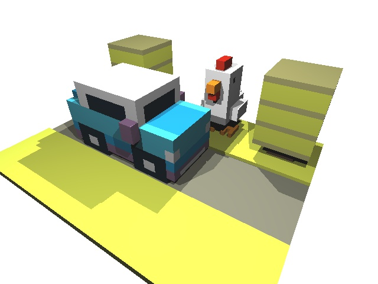
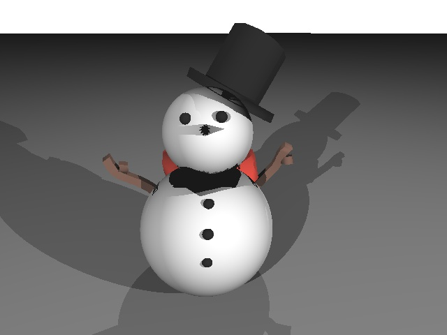
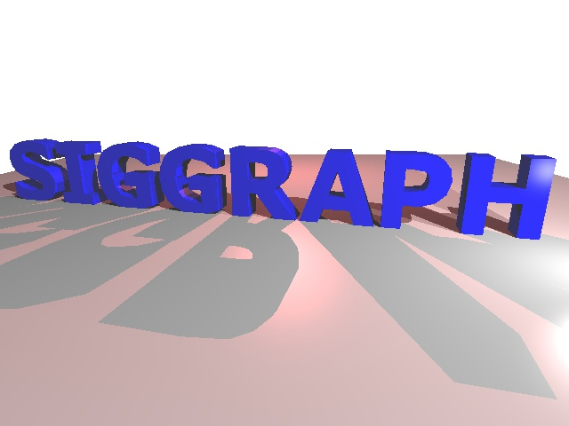

# C++ Ray Tracer

A CPU-based ray tracing renderer developed in C++ as part of a computer graphics course at the University of Southern California.

The application renders 3D scenes containing spheres, triangles, and multiple light sources, using ray-object intersection algorithms and the Phong illumination model to produce realistic lighting and shadows.

## Rendered Scenes

### Toy Scene



### Snowman Scene



### SIGGRAPH Scene



## Features

- **Ray Casting:** Generates primary rays from the camera through each pixel of the image plane.
- **Object Intersections:** Calculates ray-sphere and ray-triangle intersections.
- **Phong Illumination:** Implements diffuse and specular lighting with support for multiple light sources.
- **Smooth Shading:** Uses barycentric interpolation of vertex normals and material properties.
- **Shadows:** Casts secondary rays toward light sources to determine whether surfaces are illuminated.
- **Scene Loading:** Parses custom `.scene` files containing geometry, materials, and lighting information.
- **Image Export:** Saves rendered scenes as JPEG images.

## Technologies

- C++
- OpenGL / FreeGLUT
- GLM (OpenGL Mathematics)
- GLEW
- libjpeg
- Visual Studio 2022

## Building and Running

### Requirements

- Windows
- Visual Studio 2022 with C++ desktop development tools
- Project dependencies located in the `external/` directory

### Build Instructions

1. Clone the repository.
2. Open `RayTracer/RayTracer.sln` in Visual Studio 2022.
3. Select the Win32 platform and either Debug or Release configuration.
4. Build the solution.
5. Configure the command-line arguments in Project Properties → Debugging.

### Usage

The application accepts a scene file and an optional JPEG output filename.

```text
RayTracer.exe <input.scene> [output.jpg]
```

For example:

```text
spheres.scene output.jpg
```

The application displays the rendered scene using OpenGL and optionally writes it to a JPEG file.

## Project Background

This project originated as a computer graphics programming assignment at the University of Southern California.

The ray tracing and shading implementations were developed as part of the assignment using university-provided starter code and supporting libraries.

The project has been updated for compatibility with Visual Studio 2022 and organized for GitHub presentation.